  
    
  <table>
    <tr>
      <td valign="top"></td>
      <td valign="top"></td>
    </tr>
  </table>

### Selected projects

**[PiccoliPassi](https://github.com/Vikybassi/piccolipassi-demo)** · a multidimensional screening platform for preschool age, designed and built during my thesis internship at Koinè. [Live demo](https://piccolipassi-demo.netlify.app/) with fictitious data.

**[Back before dark](https://github.com/Vikybassi/rientro-prima-del-buio)** · pick a hike in Valtellina and a start time: it tells you whether you'll be back at the car in daylight, with walking times, sunset and mountain weather. [Open the app](https://vikybassi.github.io/rientro-prima-del-buio/).

**[Fotogram](https://github.com/Vikybassi/fotogram)** · Android client for an image-sharing social network, in Kotlin and Jetpack Compose.

   
  <a href="https://vikybassi.github.io">Portfolio</a> · <a href="https://www.linkedin.com/in/vittoria-bassi/">LinkedIn</a> · <a href="mailto:vittoria.bassi02@gmail.com">Email</a>

